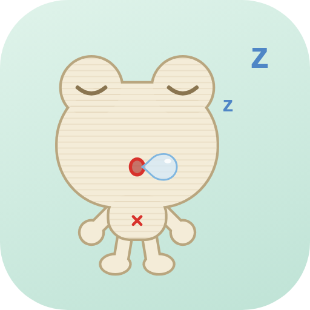
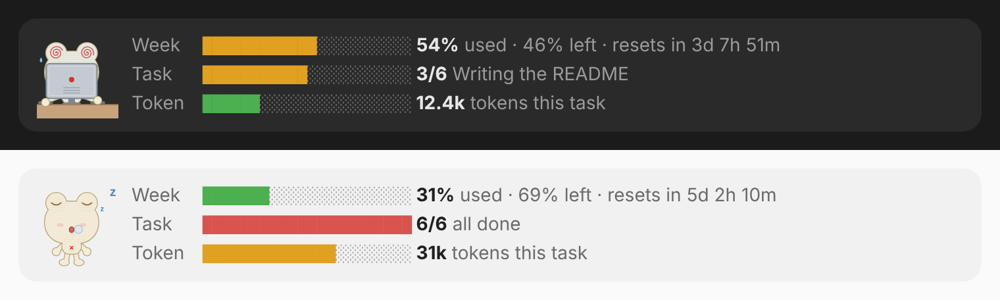
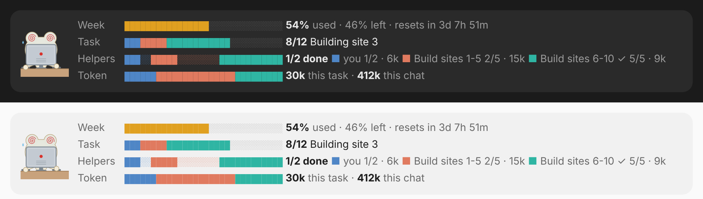
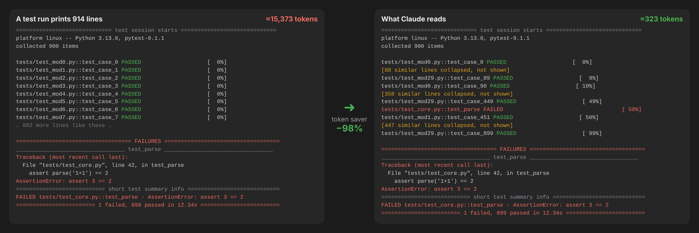
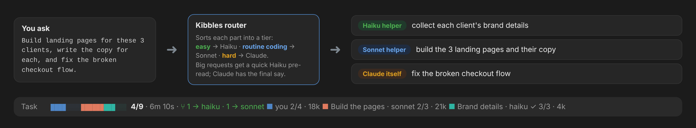
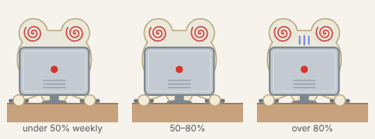
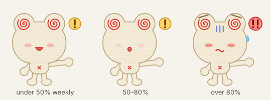

<p align="center"></p>

<h1 align="center">Kibbles - Usage HUD & Token Saver</h1>

<p align="center">
  <a href="https://github.com/Qibbles/Kibbles/releases/latest"></a>
  
  <a href="LICENSE"></a>
</p>

<p align="center">A Claude Code plugin that makes your usage limits last longer and shows you, at a glance, where they're going.<br>Meet Kibbles, the little frog who saves you tokens and keeps you company while you work.</p>



### ❌ Without Kibbles

- You find out you've hit your 5-hour or weekly limit when Claude stops.
- Test runs, builds and logs fill Claude's context with thousands of lines it never needed.
- Every part of a task runs on the biggest model, even simple search-and-summarise work.

### ✅ With Kibbles

- **A heads-up display:** a three-line band above the prompt with your weekly and 5-hour limits, task progress and timer, tokens and context, helpers in colour, and a heads-up when Claude is waiting on you.
- **A token saver:** noisy tool output is trimmed before Claude reads it. A 900-test run goes from ~15,000 tokens to ~300, with the failure kept whole. Unchanged files aren't re-read, and replies stay short.
- **A model router:** the easy parts of a task go to the cheaper Haiku model and the hard parts stay with Claude, so your limits stretch further.

There's nothing to set up or switch on. The band and the token saver run on your computer and never call a model. The router only makes a small Haiku call to plan big, multi-part requests.

## Install

<details open>
<summary><b>Claude Code (terminal)</b></summary>

```
/plugin install kibbles --marketplace Qibbles/Kibbles
```

Answer `y` to add the marketplace, then press Enter to install it for your user. The band appears right away, in every Claude Code session on that computer.

Or from a shell:

```bash
claude plugin install kibbles --marketplace Qibbles/Kibbles
```

</details>

<details open>
<summary><b>Your Claude account (desktop app or claude.ai)</b></summary>

This adds Kibbles to your account rather than to one computer. It needs a Pro, Max, Ultra, Team or Enterprise plan.

1. Open **Customize → Plugins** in the Claude desktop app, or go to [claude.ai/customize/plugins](https://claude.ai/customize/plugins).
2. Click **Add → Add marketplace**, enter `Qibbles/Kibbles`, then add the **kibbles** plugin.

   Or download [`kibbles.plugin`](https://github.com/Qibbles/Kibbles/releases/latest/download/kibbles.plugin) from the [latest release](https://github.com/Qibbles/Kibbles/releases/latest), then click **Add → Upload plugin** and choose the file.

Plugins on your account sync to Claude Code when you're signed in with that account (Claude Code v2.1.273 or later). Run `/reload-plugins` to pick it up in a session that's already open. Kibbles draws its band in Claude Code (terminal, desktop app, IDE and cloud sessions); in plain chat it has nothing to show.

</details>

<details>
<summary><b>Update, turn off or remove</b></summary>

**Update** (plugins don't update by themselves):

```bash
claude plugin marketplace update kibbles
```

```bash
claude plugin update kibbles
```

Then start a new session. `claude plugin list` shows which version you have. If you uploaded the `.plugin` file to your account, upload the new one from the latest release to replace it.

**Hide it for a moment:** press `ctrl+x` then `ctrl+a`, or click the `[-]` beside the band. Do the same to bring it back.

**Turn it off or remove it:** type `/plugin`, choose **kibbles**, then **Disable** or **Uninstall**. On your account, use **Customize → Plugins**. From a shell:

```bash
claude plugin uninstall kibbles
```

</details>

## 1. The heads-up display

The band is three lines tall:

| Row | What it means |
|---|---|
| **Week** | How much of your weekly limit you've used and when it resets, then your **5-hour limit** (`5h 23%`) and when that resets. At the end are the **days of the week so far**, each name in the colour of its part of the bar (`Mo Tu We Th`). Today is in bold. |
| **Task** | How far along the current task is, from Claude's to-do list, and **how long it has taken**: `3/6 · 4m 12s · Writing the README`. If there's no to-do list, it counts the steps Claude has taken and names the last one. When Claude is **waiting on you**, it says so: `⏸ waiting for you: allow Bash?`. |
| **Token** | Tokens used by this task (including any helpers), by the whole chat so far, what the **token saver** kept out of the chat, and how full Claude's **context window** is: `12.4k this task · 412k this chat · saved 38k · context 68%`. When the context gets near full, Claude summarises the chat to make room and can lose detail, so a high number is a hint to start a fresh chat for a new topic. |

The bars:

- **Week:** split into days, each day in its own colour, matching the coloured day names in the text. You can see which days used the most. Grey is usage from before Kibbles started counting this week.
- **Task and Token:** turn from **green** to **amber** to **red** as they fill. The 5-hour limit and the context window use the same colours in their text.

### Helpers (subagents)

When Claude hands parts of a task to helpers, the band shows who's doing what, with one colour per worker: blue for you (the main conversation) and a different colour for each helper.



- **Task bar:** one lane per worker, as wide as its share of the to-do items. The solid part of a lane is what that worker has finished; the light, dotted part in the same colour is what it still has to do. A helper at `2/5` is two-fifths solid, and a finished helper's lane is solid all the way.
- **Task text:** becomes the colour key: `■ you 1/2 · 6k`, then each helper's job, its own progress and its tokens. `✓` means that helper has finished, `✗` that it failed. A helper with no to-do list shows how many steps it has taken instead.
- **Token bar:** the whole bar is this task's tokens, split by who used what share. With no helpers, it instead fills against `taskTokenSoftCap`.

**An example:** you ask Claude to build 10 sites, and it hands sites 1–5 to one helper and 6–10 to another. The Task bar shows each helper's lane filling up, so you can see at a glance who's done and who still has work left. The key shows each helper's own `2/5` or `✓ 5/5`. The Token bar shows that the coral helper used half of the task's tokens.

## 2. The token saver



The more Claude reads, the faster you use up your limits. The token saver works by itself, runs locally and never calls a model. It works in four ways.

**1. Noisy output is condensed.** Before Claude sees the output of a shell command or an MCP tool, the saver:

- strips colour codes and progress bars;
- collapses runs of repeated log lines (`[998 similar lines collapsed, not shown]`);
- keeps the start and end of very long output (`[840 lines trimmed]`);
- shortens huge JSON values and lists.

Lines containing **error, fail, warn, traceback, exception, panic, fatal or assert are never removed**. Number-only data, such as `seq` output or a numeric CSV, is never collapsed. Claude is told that the hidden lines were not shown and must not be guessed, and that adding the comment `# nofilter` to a command gets the full output.

**2. Unchanged files aren't read twice.** If Claude reads a file again and nothing has changed, it gets a one-line note to use what it already has.

- If it asks again straight away, the read goes through.
- If the file has changed, Claude gets just the diff, provided the diff is small. Edits still work afterwards.
- The main chat and each helper are tracked separately.
- After an edit or a compaction, the next read is a full one.

**3. Terse replies.** A short style instruction asks for no preamble, no restating the question, no closing recap, and code changes shown as diffs. It never shortens code, commands or error messages. It's set once at the start of a chat, in the system prompt, so it doesn't break Claude's prompt cache. If you switch it in the settings mid-chat, Claude gets one note instead.

**4. Savings in the band.** The Token row shows how many tokens the saver kept out of the chat: `· saved 38k`. There's nothing to run: it works by itself, and you can tune or turn it off in the settings below.

**Measured savings** (estimated at ~4 characters a token; no error lines lost in any case):

| Output | Before | After | Saved |
|---|---:|---:|---:|
| A pytest run of 900 tests with 1 failure | 15,373 | 323 | 98% |
| 300 log lines with 1 error | 4,384 | 106 | 98% |
| pip install with progress bars | 965 | 65 | 93% |
| A 120-item GitHub API response | 56,102 | 4,180 | 93% |
| A coloured cargo build | 428 | 50 | 88% |
| A 16-step coding session (output + re-reads) | 92,201 | 11,122 | 88% |
| Output that was already short | – | – | 0% |

How much you save depends on how noisy your tools are: test runners, builds, logs, API JSON and re-reads save the most.

## 3. The model router



Not every part of a task needs Claude's biggest model. Searching code, collecting facts, summarising, renaming and formatting are easy work. Design, debugging and tricky changes are hard. The router sends easy parts to **Haiku**, a smaller and much cheaper model, and keeps the hard parts on Claude's own model. On Claude plans, Haiku uses up your 5-hour and weekly limits far more slowly, so the same work stretches further.

It decides everything by itself, per request, in three layers:

| Layer | When | What it does | Cost |
|---|---|---|---|
| **1. Standing instruction** | Every chat | Tells Claude: when a request has separate easy and hard parts, hand the easy, self-contained ones to Haiku helpers and do the hard ones yourself. Don't split small tasks or tightly linked parts. If a Haiku helper gets something wrong, redo it. | A few dozen tokens, once per chat, kept in the prompt cache |
| **2. Safety net** | Whenever Claude starts a helper without choosing a model | If the helper's job reads as easy (search, read, explore, summarise, list, format, docs…), it runs on Haiku. Anything that sounds hard (design, debug, fix, refactor, review, plan…) is left alone. | Free |
| **3. Pre-read** | Only for **big, multi-part** requests: three or more listed jobs, "these 10 sites", "all the endpoints", or a long message | Before Claude starts, Haiku reads your message and lists its easy and hard parts. Claude gets that list as a suggestion and still decides. Short questions and follow-ups like "yes, go ahead" skip this. | One small Haiku call, usually a few hundred tokens, counted in the band |

**When limits run low**, past 80% of your 5-hour or weekly limit, it leans harder on Haiku. Claude is told once to delegate more readily, the safety net sends any helper that isn't clearly hard to Haiku, and the pre-read also kicks in for medium-sized requests.

**What you see in the band:**
- **Task row:** `⑂ 2 easy → haiku` when the pre-read split a request.
- **Helper key:** each helper's model, when it differs from Claude's own: `■ Write the copy · haiku 3/3 · 9k`.

**What it won't do:** it never changes the model of your main conversation. It never touches a helper Claude gave a model to on purpose. It never routes forks or teammates.

## Meet Kibbles

Kibbles is a little frog who shows what Claude is doing.

**Working:** while Claude is on a task, Kibbles sits behind a big computer, typing away, with its spiral eyes spinning.



**Waiting for you:** when Claude needs your permission or an answer, Kibbles stands up and waves at you, with a "!" bubble.



**Napping:** when nothing is running, Kibbles naps, breathing slowly, its mouth opening into a little "o" and blowing a teardrop-shaped snore bubble, with floating z's.


Kibbles' mood follows your weekly usage, and each mood looks clearly different:

| Weekly usage | Working | Waiting for you | Napping |
|---|---|---|---|
| **Under 50%**: happy | A green ♪ floats up; relaxed typing; slow spin; no sweat | Open smile, yellow "!" | Smiling, a pink ♥ floats up |
| **50–80%**: neutral | One sweat drop; normal typing | Little "o" mouth, yellow "!" | Calm, straight mouth |
| **Over 80%**: worried | Blue worry lines, steam puffing off its head, three sweat drops, frantic typing, nervous jitter, eyes spinning backwards | Worry lines, furrowed brows, wobbly frown, sweat, red "!!" | Worry lines, furrowed brows, sweat, tossing and turning |

## Settings

On first run it creates `~/.claude/kibbles.json`. Edit it any time; changes apply on your next message.

```json
{
  "weeklyTokenLimit": 5000000,
  "resetDay": "mon",
  "resetTime": "09:00",
  "utcOffsetHours": 8,
  "taskTokenSoftCap": 50000
}
```

| Setting | What it does |
|---|---|
| `taskTokenSoftCap` | How many tokens fill the Token bar (default 50,000). It's only a scale for the bar, not a limit. |
| `weeklyTokenLimit` | Only used if your plan doesn't report its weekly limit (see below). Your weekly allowance in tokens, as a guess. |
| `resetDay`, `resetTime` | Only used in the same case. When your week resets, e.g. `"mon"` and `"09:00"`. |
| `utcOffsetHours` | The timezone for `resetDay` and `resetTime`, in hours from UTC (8 for Singapore, 0 for London in winter, -5 for New York in winter). It defaults to your computer's timezone. |
| `tokenSaver` | The token saver's settings (below). |

### Token saver settings

They go in a `"tokenSaver"` section. Put it in `~/.claude/kibbles.json` for all projects, or in `.claude/kibbles.json` inside a project for that project only; the project's file wins. Changes apply on your next message. To turn the token saver off, set `"enabled": false`.

```json
{ "tokenSaver": { "enabled": true, "terse": true, "filter": { "maxLines": 400 } } }
```

| Setting | Default | What it does |
|---|---|---|
| `enabled` | `true` | The whole token saver |
| `terse` | `true` | Terse replies |
| `filter.enabled` | `true` | Condensing tool output |
| `filter.tools` | `["Bash", "mcp__.*"]` | Which tools' output is condensed (patterns matched against the tool name) |
| `filter.maxLines` | `200` | Longer output keeps only its start and end… |
| `filter.headLines`, `filter.tailLines` | `60`, `60` | …this many lines of each |
| `filter.maxLineChars` | `2000` | A longer single line is cut in the middle |
| `filter.minRepeat` | `3` | How many repeated lines it takes to collapse them (runs of 4 or more actually shrink) |
| `filter.jsonMaxString`, `filter.jsonMaxArray` | `400`, `30` | JSON values and lists longer than this are shortened |
| `filter.minSavingsTokens` | `30` | Output is left untouched unless it saves at least this many tokens |
| `filter.protectPattern` | `error\|fail\|warn\|…` | Lines matching this are never removed |
| `filter.stripAnsi`, `filter.stripProgress`, `filter.collapseRepeats` | `true` | Each step on its own |
| `dedupe.enabled` | `true` | Skipping unchanged re-reads |
| `dedupe.diff` | `true` | Sending a diff for a changed file |
| `dedupe.maxDiffRatio` | `0.5` | Only when the diff is smaller than this share of the file |
| `dedupe.minTokens` | `150` | Smaller reads are never skipped |

### Model router settings

There's nothing to set. If you ever want to change it, add a `"router"` section to `~/.claude/kibbles.json`:

```json
{ "router": { "enabled": true, "cheapModel": "haiku", "maxPreReadsPerChat": 20 } }
```

| Setting | Default | What it does |
|---|---|---|
| `enabled` | `true` | The whole router: instruction, safety net and pre-read |
| `cheapModel` | `"haiku"` | The model easy work goes to |
| `maxPreReadsPerChat` | `20` | At most this many pre-reads in one chat |

## Where the numbers come from

- **Week:** comes straight from your Claude plan's real weekly limit, which Claude subscriptions report. If your plan doesn't report one (for example, API-key billing), Kibbles estimates it from the tokens it has counted and the settings above, and adds **(est.)** to the row.
- **5-hour limit and context:** reported by Claude Code itself, so they're real figures. They appear once the first reply of a chat has come back.
- **Days:** Kibbles notes your weekly percentage as the days go by, so it can only split days it was running for. Usage from before it started counting shows as grey.
- **Task:** read from Claude's own to-do list as it updates.
- **Token:** the new input and output tokens of every request in the task, including every helper's. "This chat" counts from when Kibbles started running in that chat. Tokens served from Claude's prompt cache aren't counted, so this is "new work done", not everything the model read.

## Costs and privacy

- **Almost free to run:** the band and the token saver never call a model, so they use **zero tokens**. The token saver cuts the tokens Claude reads. The router's only cost is a small Haiku pre-read on big, multi-part requests. Its tokens are counted in the band like any others.
- **Updates on events:** it updates when something happens (a message, a tool call, a usage change). It never polls, and redraws at most once a second.
- **Stays on your computer:** everything runs locally. Nothing is sent anywhere except the router's pre-read, which goes to Claude like any other request. The only file it writes is its own settings file.

## Where it works

The band fits any width. On a narrow window each row switches to shorter wording (`85% used · resets in 2d 5h 13m` becomes `85% · resets 2d 5h`, then just `85%`). Long names are trimmed with `…`; file paths are trimmed in the middle so you still see the file name. If there are more helpers than fit, the last entry reads `+N more`.

- **Claude Code desktop app and IDE extensions:** Kibbles is an animated drawing.
- **Terminal:** Kibbles is drawn as small pictures where your terminal supports images. Otherwise it's a tiny text face, `(@ω@)` when working or `(-‿-) z` when napping.

## For developers

```bash
claude plugin validate .
```

```bash
claude plugin test .
```

The band lives in `hooks/register.tsx` and Kibbles in `hooks/mascot.ts`. The token saver is in `hooks/saver/`: `filters.ts` (output condensing), `dedupe.ts` and `diff.ts` (re-reads), `saver.ts` (its hooks), each with a `*.test.ts` file. The model router is in `hooks/router/router.ts`, with tests in `router.test.ts`. Every filter has fixture-based tests, including checks that no error line is ever lost. The frames in `assets/` are the terminal's pictures of Kibbles.

## License

[MIT](LICENSE) © Qibbles
