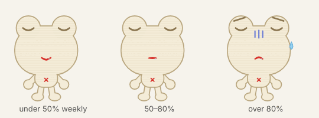

# CuteStatus 🐸

A tiny, live status band that sits just above the Claude Code prompt. At a glance it shows how much of your weekly usage is gone, how far along the current task is, and how many tokens that task has used. A little frog keeps you company while you work.


## What it shows

The band is three lines tall, plus a fourth while helpers are working:

| Row | What it means |
|---|---|
| **Week** | How much of your weekly usage limit you've used, how much is left, and when it resets, e.g. `54% used · 46% left · resets in 3d 7h 51m`. |
| **Task** | How far along the current task is, from Claude's to-do list (`3/6 Writing the README`). If there's no to-do list, it counts the steps Claude has taken and names the last one. |
| **Token** | The **total** tokens the current task has used so far, including any helpers (`12.4k tokens this task`). When helpers are working it also shows the split: `30k tokens this task · you 6k + helpers 24k`. It starts again from zero each time you send a new message. |
| **Helpers** | Only shown while Claude has handed parts of the task to helpers (subagents). One entry per helper: `●` working, `✓` finished, `✗` failed, then its job, its progress and its tokens, e.g. `● Build sites 1-5 3/5 · 15k   ✓ Build sites 6-10 5/5 · 9k`. The bar fills as helpers finish. |

Each bar turns from **green** to **amber** to **red** as it fills.

**An example:** you ask Claude to build 10 sites, and it hands sites 1–5 to one helper and 6–10 to another. The Task row counts all 10 to-do items together. The Token row shows the grand total, split into what Claude used directly and what the helpers used. The Helpers row shows each helper's own progress (`3/5`) and tokens. A helper with no to-do list shows how many steps it has taken instead.

## Meet the frog

The frog shows what Claude is doing.

**Working:** while Claude is on a task, the frog sits behind a big computer, typing away, with its spiral eyes spinning and sweat dripping down.


**Napping:** when nothing is running, it sleeps, breathing slowly, with its mouth opening into a little "o", a snore bubble and floating z's.



Its mood follows your weekly usage:

| Weekly usage | Working | Napping |
|---|---|---|
| Under 50% | 1 sweat drop, relaxed spin | smiling |
| 50–80% | 2 sweat drops, faster spin | straight face |
| Over 80% | 3 sweat drops, eyes spinning backwards | worried, with a sweat drop |

## Install

You need [Claude Code](https://claude.com/claude-code). In a Claude Code session, type:

```
/plugin install cute-status --marketplace Qibbles/CuteStatus
```

Answer `y` to add the marketplace, then press Enter to install it for your user. The band appears right away.

Or from a shell:

```bash
claude plugin install cute-status --marketplace Qibbles/CuteStatus
```

In the Claude desktop app, where `/plugin` doesn't run: click **+** next to the prompt box, then **Plugins**, **Add marketplace**, enter `Qibbles/CuteStatus`, then **Add plugin**.

## Turn it off or remove it

- **Hide it for a moment:** press `ctrl+x` then `ctrl+a`, or click the `[-]` beside the band. Do the same to bring it back.
- **Turn it off or remove it:** type `/plugin`, choose **cute-status** from your installed plugins, then **Disable** or **Uninstall**. From a shell:

```bash
claude plugin uninstall cute-status
```

## Settings

On first run it creates `~/.claude/cute-status.json`. Edit it any time; changes apply on your next message.

```json
{
  "weeklyTokenLimit": 5000000,
  "resetDay": "mon",
  "resetTime": "09:00",
  "utcOffsetHours": 8,
  "taskTokenSoftCap": 50000
}
```

| Setting | What it does |
|---|---|
| `taskTokenSoftCap` | How many tokens fill the Token bar (default 50,000). It's only a scale for the bar, not a limit. |
| `weeklyTokenLimit` | Only used if your plan doesn't report its weekly limit (see below). Your weekly allowance in tokens, as a guess. |
| `resetDay`, `resetTime` | Only used in the same case. When your week resets, e.g. `"mon"` and `"09:00"`. |
| `utcOffsetHours` | The timezone for `resetDay` and `resetTime`, in hours from UTC (8 for Singapore, 0 for London in winter, -5 for New York in winter). It defaults to your computer's timezone. |

## Where the numbers come from

- **Week:** comes straight from your Claude plan's real weekly limit, which Claude subscriptions report. If your plan doesn't report one (for example, API-key billing), CuteStatus estimates it from the tokens it has counted and the settings above, and adds **(estimate)** to the row.
- **Task:** read from Claude's own to-do list as it updates.
- **Token:** the new input and output tokens of every request in the task, including every helper's. Tokens served from Claude's prompt cache aren't counted, so this is "new work done", not everything the model read.

## Costs and privacy

- **Free to run:** it never calls the model, so it uses **zero tokens**.
- **Updates on events:** it updates when something happens (a message, a tool call, a usage change). It never polls, and redraws at most once a second.
- **Stays on your computer:** everything runs locally. Nothing is sent anywhere, and the only file it writes is its own settings file.

## Where it works

- **Claude Code desktop app and IDE extensions:** the frog is an animated drawing.
- **Terminal:** the frog is drawn as small pictures where your terminal supports images. Otherwise it's a tiny text face, `(@ω@)` when working or `(-‿-) z` when napping.

## For developers

```bash
claude plugin validate .
```

```bash
claude plugin test .
```

The band lives in `hooks/register.tsx` and the frog in `hooks/mascot.ts`. The frames in `assets/` are the terminal's pictures of the frog.

## License

[MIT](LICENSE) © Qibbles
